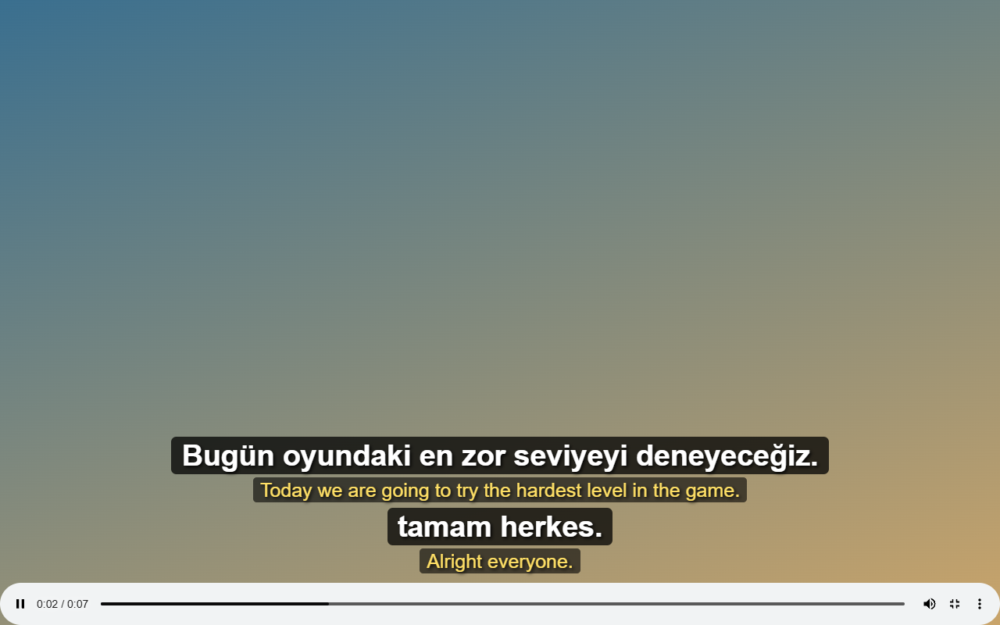

#  Babil

**Watch videos in your language. Live captions, translated on your computer.**



## ✨ What you get

- 🌍 Translate videos into 26 languages on YouTube, Twitch, Kick, and more
- 💬 See original and translated captions together, including in fullscreen
- 🔊 Hear translations read aloud, with the video turned down while each sentence is spoken (Chrome)
- 🎙️ Choose a voice persona and press **Listen** to hear a sample; each persona is its own natural voice, downloaded once and played on your computer
- 🗣️ Babil's own screens are in English, Turkish, Spanish, Hindi, and Simplified Chinese, following your browser's language
- 🎨 Drag captions to move them; customize their font, size, and colors
- 🔒 Audio stays on your computer. Free, with no account or API key needed

## 📦 Install

You'll need **Chrome 138 or newer, or Firefox 142 or newer, on a desktop computer**. A graphics card helps it run faster.

1. Download the **Babil ZIP** from the [latest release](https://github.com/canmenzo/babil/releases/latest) and unzip it
2. Type `chrome://extensions` into Chrome's address bar and press Enter
3. Turn on **Developer mode** in the top-right corner
4. Click **Load unpacked** and choose the unzipped folder containing `manifest.json`

> 📌 Click the puzzle-piece icon in Chrome's toolbar, then pin Babil so it's easy to find.

### Firefox

Firefox is not included in the current GitHub release ZIP. To build it from source, run `npm install` and `npm run build:firefox`; then load `dist-firefox/manifest.json` from `about:debugging#/runtime/this-firefox` using **Load Temporary Add-on...**.

Firefox captures audio from the playing page's video element. Protected media and players that do not expose an audio track cannot be captured. The first Firefox translation requires an extra download (up to about 1.1 GB); audio and captions are processed on your computer.

## ▶️ Start watching

1. Play a video and click the **Babil icon** in Chrome's toolbar
2. Choose the language you want captions translated into. Leave the model on automatic
3. Click the **large button at the top** to start captions, or press `Alt+Shift+T`

The first start downloads a speech model (about **600 MB** on automatic). Wait for it to finish; future starts use the saved copy.

🔊 To hear the translation, tick **Read translation aloud** in Babil's panel. Pick a voice persona under **Voice** in the panel, or on the settings page, where **Listen** plays a sample of each. Persona names differ per language (in English: Iris, Ruby, Owen, Miles, Grace, Skye).

Each persona has its own voice, which Babil downloads once and then plays on your computer, so the captions it reads stay on your computer. One download of about **210 MB** covers 22 languages, including English, Turkish, Spanish, Hindi, Arabic, Japanese and Korean; Chinese has two voices of **63 MB** each, shared by the personas at different speeds and pitches. The settings page shows for every persona which voice it uses and whether it is downloaded, with a progress bar while it downloads, and **Delete** frees the space again. Until a voice is downloaded, and for Bengali and Thai, a system voice reads aloud instead; Babil picks one on your computer over an online one when it can (add more in **Settings > Time & language > Speech** on Windows or **System Settings > Accessibility > Spoken Content** on macOS). **Custom** always uses your own system voice and speed.

💡 For better accuracy, select the video's spoken language. Use the **Settings** button at the bottom of Babil's panel to change how captions look.

## 🔄 Update

Chrome Web Store and Firefox Add-ons installations update automatically through the browser when a newer version is published to the same store listing. Babil does not check GitHub for updates. Your settings and downloaded models stay saved.

Developer-mode ZIP and temporary Firefox installations do not receive automatic updates. Replace the files, then reload the extension from `chrome://extensions` or `about:debugging`. Downloaded models stay as long as the extension is not removed. Removing it deletes them.

To publish an update, increase the version in `package.json`, `package-lock.json`, and both manifests, build with `npm run build:store` and `npm run build:firefox`, then upload a ZIP of each output folder's contents to the existing Chrome Web Store and Firefox Add-ons listings. Keep the Firefox add-on ID (`babil@canmenzo`) unchanged and omit custom `update_url` values so the stores manage updates. A GitHub push or release alone does not update installed extensions.

## 🛠️ For developers

```sh
npm install
npm run build   # Output: dist/
```

Uses Whisper via transformers.js and Chrome's on-device Translator API. Firefox uses a Transformers.js translation model locally.

### Store listing assets

The product screenshot is used for both browser listings:


- Chrome Web Store screenshot: `docs/store/chrome/01-captions.png` (1280 × 800)
- Chrome Web Store small promo tile: `docs/store/chrome/small-promo.png` (440 × 280)
- Firefox Add-ons screenshot: `docs/store/firefox/01-captions.png` (1280 × 800)

Build the Firefox package with `npm run build:firefox` (output: `dist-firefox/`).

## 📄 License

MIT. The downloadable voices have their own licenses:

- [Supertonic 3](https://huggingface.co/supertone-oss-archive/supertonic-3) by Supertone (22 languages): OpenRAIL-M. Babil downloads a [copy with an 8-bit vector estimator](https://huggingface.co/payam1394/traxlate-supertonic-3-q8ve), or the original if that copy is gone. Babil's Supertonic code is ported from Supertone's MIT sample code.
- [Xiao Ya](https://huggingface.co/rhasspy/piper-voices/tree/main/zh/zh_CN/xiao_ya/medium) (Piper, Chinese): trained on the Biaobei dataset, non-commercial use only.
- [Chaowen](https://huggingface.co/rhasspy/piper-voices/tree/main/zh/zh_CN/chaowen/medium) (Piper, Chinese): CC0 dataset, fine-tuned from Xiao Ya.
