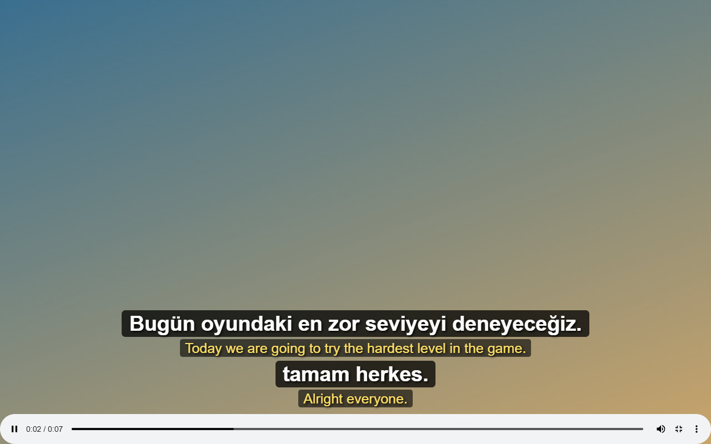

# 🗼 Babil

**Watch videos in your language. Live captions, translated on your computer.**



## ✨ What you get

- 🌍 Translate videos into 26 languages on YouTube, Twitch, Kick, and more
- 💬 See original and translated captions together, including in fullscreen
- 🔊 Hear translations read aloud, with the video turned down while each sentence is spoken (Chrome)
- 🎙️ Choose a voice persona (Lale, Ayla, Deniz, Ateş, Bilge, Rüzgar) and press **Dinle** to hear a sample
- 🎨 Drag captions to move them; customize their font, size, and colors
- 🔒 Audio stays on your computer. Free, with no account or API key needed

## 📦 Install

You'll need **Chrome 138 or newer, or Firefox 142 or newer, on a desktop computer**. A graphics card helps it run faster.

1. Download the **Babil ZIP** from the [latest release](https://github.com/canmenzo/babil/releases/latest) and unzip it
2. Type `chrome://extensions` into Chrome's address bar and press Enter
3. Turn on **Developer mode** in the top-right corner
4. Click **Load unpacked** and choose the unzipped folder containing `manifest.json`

> 📌 Click the puzzle-piece icon in Chrome's toolbar, then pin Babil so it's easy to find.

### Firefox

Firefox is not included in the current GitHub release ZIP. To build it from source, run `npm install` and `npm run build:firefox`; then load `dist-firefox/manifest.json` from `about:debugging#/runtime/this-firefox` using **Load Temporary Add-on...**.

Firefox captures audio from the playing page's video element. Protected media and players that do not expose an audio track cannot be captured. The first Firefox translation requires an extra download (up to about 1.1 GB); audio and captions are processed on your computer.

## ▶️ Start watching

1. Play a video and click the **Babil icon** in Chrome's toolbar
2. Choose the language you want captions translated into. Leave the model on automatic
3. Click the **large button at the top** to start captions, or press `Alt+Shift+T`

The first start downloads a speech model (about **600 MB** on automatic). Wait for it to finish; future starts use the saved copy.

🔊 To hear the translation, tick **Çeviriyi sesli oku** (read the translation aloud) in Babil's panel. Pick a voice persona under **Ses** in the panel, or on the settings page, where **Dinle** plays a sample of each. Personas use voices already on your computer, and a voice on your computer is chosen over an online one, so captions are not sent to an online voice when a local one exists. Add more voices in your system's speech settings (Windows: **Settings > Time & language > Speech**; macOS: **System Settings > Accessibility > Spoken Content**). **Özel** keeps your own voice and speed.

💡 For better accuracy, select the video's spoken language. Use the link at the bottom of Babil's panel to change how captions look.

## 🔄 Update

Babil's panel tells you when an update is ready. Download the new ZIP, unzip it into your existing Babil folder, and replace the old files. Then click the reload button in Babil's update notice. Your settings and downloaded models stay saved.

## 🛠️ For developers

```sh
npm install
npm run build   # Output: dist/
```

Uses Whisper via transformers.js and Chrome's on-device Translator API. Firefox uses a Transformers.js translation model locally.

### Store listing assets

The product screenshot is used for both browser listings:


- Chrome Web Store screenshot: `docs/store/chrome/01-captions.png` (1280 × 800)
- Chrome Web Store small promo tile: `docs/store/chrome/small-promo.png` (440 × 280)
- Firefox Add-ons screenshot: `docs/store/firefox/01-captions.png` (1280 × 800)

Build the Firefox package with `npm run build:firefox` (output: `dist-firefox/`).

## 📄 License

MIT
