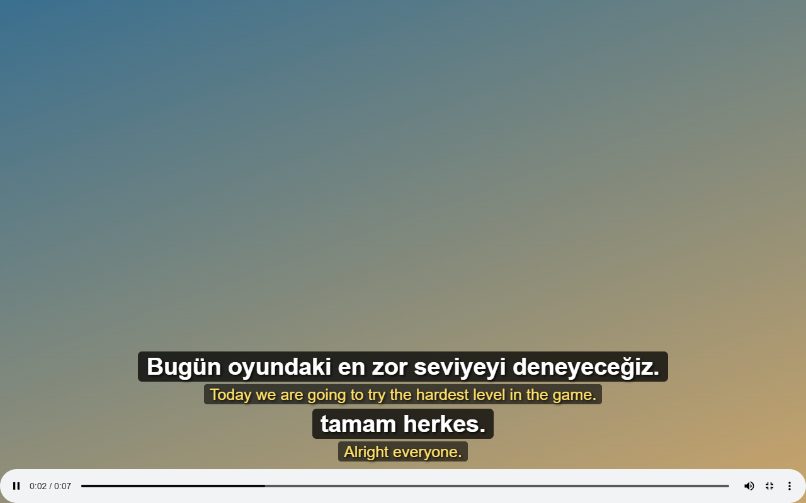

#  Babil

**Watch videos in your language. Live captions, translated on your computer.**

- 🌍 Translate videos into 26 languages on YouTube, Twitch, Kick, and more
- 💬 See original and translated captions together, even in fullscreen
- 🔊 Hear translations read aloud in a natural voice
- 🔒 Audio stays on your computer. Free, with no account or API key

## 📦 Install

Needs Chrome 138 or newer, or Firefox 142 or newer, on a desktop computer.

### Chrome

**[Add Babil to Chrome from the Chrome Web Store](https://chromewebstore.google.com/detail/babil-live-captions-and-t/cefpfhjoeffkhappaalllkoehccfcokk).** It updates automatically.

To install a release ZIP instead:

1. Download the ZIP from the [latest release](https://github.com/canmenzo/babil/releases/latest) and unzip it
2. Go to `chrome://extensions` and turn on **Developer mode**
3. Click **Load unpacked** and choose the unzipped folder

### Firefox

Babil for Firefox is in review on Firefox Add-ons. Until it is listed there, build it from source (needs Node.js):

1. Run `npm install`, then `npm run build:firefox`
2. Go to `about:debugging#/runtime/this-firefox`, click **Load Temporary Add-on** and choose `dist-firefox/manifest.json`

A temporary add-on is removed when Firefox restarts. The first Firefox translation downloads an extra model of up to about 1.1 GB.

## ▶️ Use

1. Play a video and click the **Babil icon** in the toolbar
2. Choose your language
3. Click the **large button at the top**, or press `Alt+Shift+T`

The first start downloads a speech model (up to about 600 MB).

## 📄 License

MIT. Downloadable voices have their own licenses:

- [Supertonic 3](https://huggingface.co/supertone-oss-archive/supertonic-3): OpenRAIL-M
- [Xiao Ya](https://huggingface.co/rhasspy/piper-voices/tree/main/zh/zh_CN/xiao_ya/medium): non-commercial use only
- [Chaowen](https://huggingface.co/rhasspy/piper-voices/tree/main/zh/zh_CN/chaowen/medium): CC0 dataset, fine-tuned from Xiao Ya
